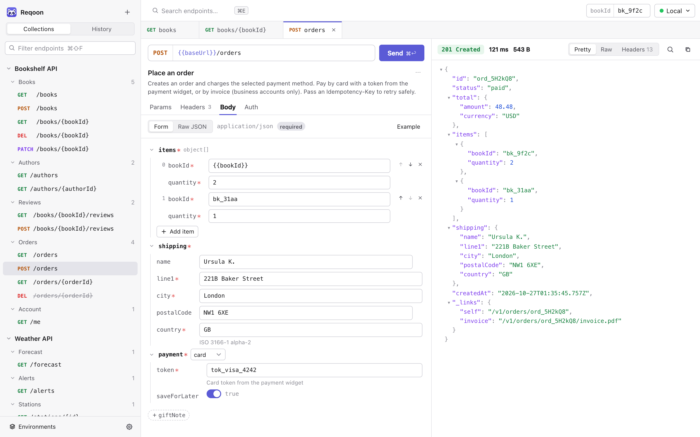
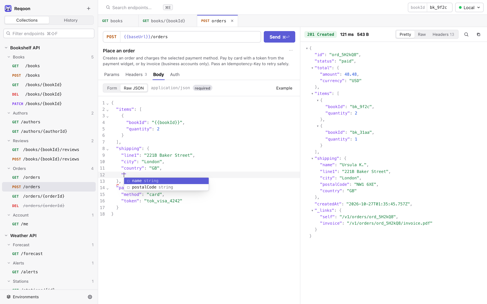
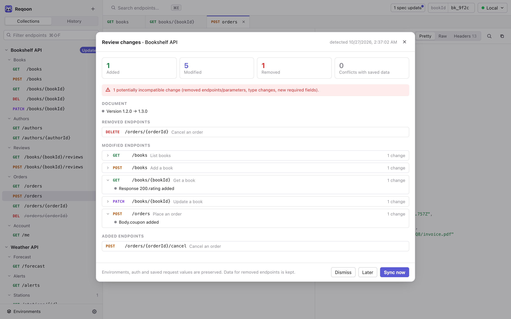
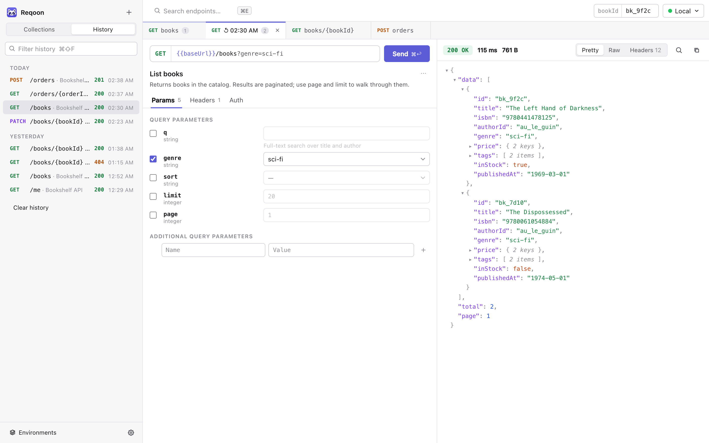
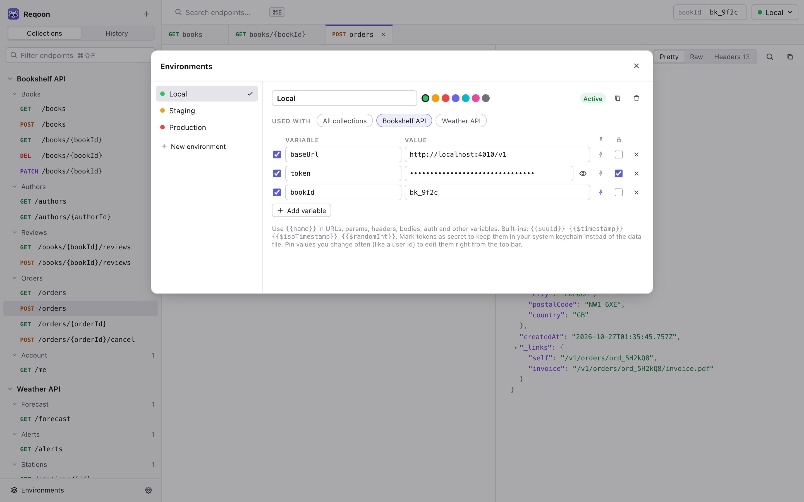
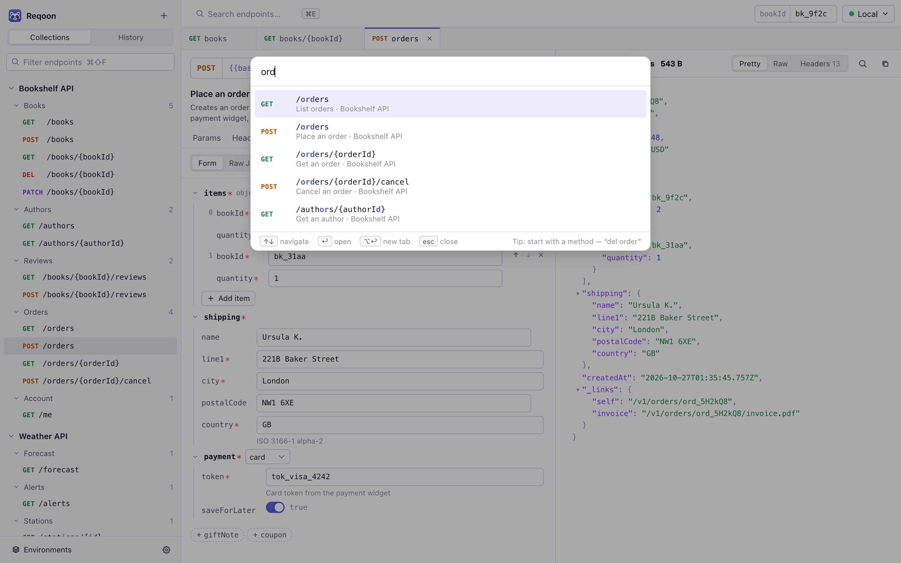

<p align="center">
  
</p>

<h1 align="center">Reqoon</h1>

<p align="center">
  A fast, local-first desktop REST client that turns your OpenAPI spec into the UI.
</p>

<picture>
  <source media="(prefers-color-scheme: dark)" srcset="docs/screenshots/hero-dark.png">
  
</picture>

Import an OpenAPI 3.0/3.1 spec and every endpoint becomes a ready-to-send request. Bodies are edited through forms generated from the schema, with validation, enums, `oneOf` variants and descriptions in place. Reqoon watches the spec, shows what changed, and lets you review the update before it touches your saved requests. No account and no cloud: secrets live in the system keychain. The release `.app` is about 5 MB.

## Features

**Requests from the spec**
- Collections are imported from a URL, a file or pasted text (JSON or YAML) and grouped by tag or path.
- Path, query and header parameters get typed inputs; optional ones can be switched on one at a time.
- Request bodies are edited as a schema-generated form, or as Raw JSON with schema-aware autocompletion, lint and examples. Both views edit the same body.
- Descriptions from the spec (Markdown or HTML) are rendered next to the fields they describe.

**Spec sync you can review**
- File and URL sources are monitored. When the spec changes you get a summary of added, modified and removed endpoints, field-level details, and a warning about incompatible changes.
- Syncing keeps environments, credentials and saved values. Data for removed endpoints is kept, and the previous version can be restored.

**Environments and auth**
- `{{variables}}` work everywhere: URL, params, headers, body, auth and other variables. Built-ins include `{{$uuid}}` and `{{$timestamp}}`.
- Secret values are stored in the OS keychain, never in the data file.
- Frequently changed values can be pinned to the toolbar.
- Environments can be limited to specific collections. A request that uses variables from an environment that doesn't fit its collection won't be sent.
- Auth comes from the spec's security schemes (Bearer, Basic, API key, OAuth token). When an API accepts several schemes, you pick which one to send. You can add your own schemes too.
- Collection-wide headers can be added, and automatic headers (`User-Agent`, `Accept`, …) can be changed or turned off per collection or per request.

**Fast to work with**
- Fuzzy endpoint search across all collections (<kbd>⌘E</kbd>). Start the query with a method to filter, e.g. "del order".
- Request history (<kbd>⌘Y</kbd>) stores each request with its response. Any entry reopens in a tab and can be sent again. Credentials are masked in history.
- Tabs can be reordered, duplicated and renamed, and closed tabs can be reopened.
- Responses can be viewed pretty-printed with folding, raw, or as headers. You can search within a response and copy a request as cURL.
- Shortcuts are configurable. Light and dark themes follow the system.

## Screenshots

<table>
  <tr>
    <td width="50%">
      <picture>
        <source media="(prefers-color-scheme: dark)" srcset="docs/screenshots/raw-dark.png">
        
      </picture>
      <p align="center"><sub>Raw JSON with completion from the schema</sub></p>
    </td>
    <td width="50%">
      <picture>
        <source media="(prefers-color-scheme: dark)" srcset="docs/screenshots/sync-dark.png">
        
      </picture>
      <p align="center"><sub>Reviewing a spec update before syncing</sub></p>
    </td>
  </tr>
  <tr>
    <td width="50%">
      <picture>
        <source media="(prefers-color-scheme: dark)" srcset="docs/screenshots/history-dark.png">
        
      </picture>
      <p align="center"><sub>History: reopen any request with its response</sub></p>
    </td>
    <td width="50%">
      <picture>
        <source media="(prefers-color-scheme: dark)" srcset="docs/screenshots/environments-dark.png">
        
      </picture>
      <p align="center"><sub>Environments, secrets in the keychain</sub></p>
    </td>
  </tr>
  <tr>
    <td colspan="2">
      <picture>
        <source media="(prefers-color-scheme: dark)" srcset="docs/screenshots/palette-dark.png">
        
      </picture>
      <p align="center"><sub>Jump to any endpoint with <kbd>⌘E</kbd></sub></p>
    </td>
  </tr>
</table>

## Install

Download the installer for your OS from [Releases](../../releases/latest).

**macOS (Homebrew).** This is the easiest way, and updates come through `brew upgrade`:

```bash
brew tap catdarick/reqoon https://github.com/catdarick/reqoon
brew trust --cask catdarick/reqoon/reqoon   # newer Homebrew asks to trust casks from third-party taps once
brew install --cask reqoon
```

**macOS (manual).** Open `Reqoon_<version>_universal.dmg` and drag Reqoon to Applications. The app isn't notarized by Apple, so macOS will say it "is damaged" or "can't be opened" until you clear the quarantine flag once:

```bash
xattr -cr /Applications/Reqoon.app
```

**Windows.** Run the `.msi` or `-setup.exe`. SmartScreen warns about an unknown publisher: choose *More info → Run anyway*.

**Linux.** Use the `.AppImage` (`chmod +x` it and run it) or install the `.deb`. Secrets are stored through the Secret Service (GNOME Keyring, KWallet).

Because builds are unsigned, macOS may ask again for keychain access after an update. Choose *Always Allow*.

## Develop

Common commands are in [`Taskfile.yml`](Taskfile.yml) ([Task](https://taskfile.dev), `brew install go-task`); run `task` to list them:

```bash
task install           # npm install
task dev               # desktop app with hot reload
task web               # UI only in a browser (uses fetch/localStorage fallbacks)
task test              # unit tests for schema, diff, request building, search
task check             # tsc + cargo check
task build             # release bundles for the current OS
task install:app       # build and copy Reqoon.app to /Applications
```

Stack: Tauri 2 (Rust, reqwest) + React + TypeScript + CodeMirror 6. The Rust toolchain is pinned in `rust-toolchain.toml` (1.90); rustup installs it on first build.

### Release

```bash
task release              # 0.1.0 → 0.1.1
task release -- minor     # 0.1.0 → 0.2.0
task release -- 1.0.0
```

This bumps the version in `tauri.conf.json`, `package.json`, `Cargo.toml` and both lockfiles. It then runs the checks, commits `Release vX.Y.Z`, tags the commit and pushes the branch and the tag. The working tree must be clean.

[`release.yml`](.github/workflows/release.yml) runs the tests and builds the macOS universal `.dmg`, the Windows `.msi`/`.exe` and the Linux `.AppImage`/`.deb`. It publishes them as a GitHub release, then commits the new version and checksum to [`Casks/reqoon.rb`](Casks/reqoon.rb).

### Layout

- `src-tauri/src/lib.rs`: HTTP execution (reqwest, cancellable), file reads for spec watching, atomic state persistence in the app data dir, and OS keychain access.
- `src/lib/`: OpenAPI parsing and `$ref`/`allOf` resolution (`openapi.ts`, `schema.ts`), request building and auth (`request.ts`), variables (`vars.ts`), spec diffing (`diff.ts`, `syncDiff.ts`), raw-JSON cursor context (`jsontext.ts`), search and shortcuts.
- `src/store/`: app state, persistence, environments and secrets, monitoring and sync (`app.ts`), and request history (`history.ts`).
- `src/components/`: UI. `SchemaForm.tsx` is the generated form, and `JsonEditor.tsx` is the raw editor with completion and lint.

## Data & privacy

- State is stored in `state.json` in the app data folder. It includes collections, request values, environments without secret values, and settings. Each spec is stored as `spec_<id>.json`, and history as `history.json`.
- Secret environment variables and auth credentials go into one OS keychain entry (`dev.reqoon.app` / `vault`).
- Nothing is sent anywhere except the requests you make and the spec URLs you import.
